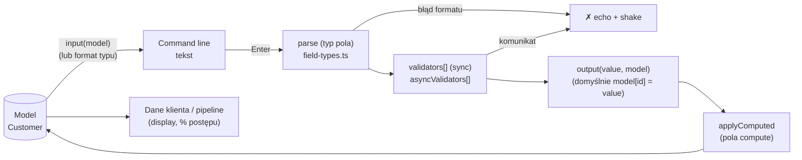

# Przepływ danych

## Jeden wpis w command line



- **Wejście** (`fieldPrefill`): obecna wartość → `suggest` (podpowiedź, oznaczona w echo) →
  `defaultValue` → pierwsza opcja słownika (`preselect`, domyślnie dla select/boolean).
- **Parse** zamienia tekst na wartość domenową (telefon → 9 cyfr, data → ISO, select → kod słownika).
- **Walidacja** dostaje wartość po parse; pierwszy komunikat zatrzymuje wpis.
- **Wyjście** zapisuje do modelu; potem silnik przelicza wszystkie pola `compute`.

## Cały przepływ i backend

```mermaid
sequenceDiagram
  participant O as Operator
  participant E as IntakeEngine
  participant G as GroupDef.onComplete
  participant A as ClientApi (mock / HTTP)
  participant MP as Mappery

  O->>E: wpisy pól (Dane podstawowe)
  E->>G: grupa kompletna i zmieniona
  G->>MP: toPreliminaryDto(model)
  G->>A: savePreliminary(dto, clientId)
  A-->>G: { clientId }
  G-->>E: toast „Zapisano wstępne dane klienta"

  O->>E: kod polecający (#1234)
  E->>A: searchReferrals(code)  (CollectionDef.load)
  A-->>MP: ReferralCandidateDto[]
  MP-->>E: Person[] (fromReferralCandidateDto)
  O->>E: wybór ✕, pytania o każdą osobę

  E->>E: koniec przepływu → complete()
  E->>G: zaległe zapisy grup (czeka)
  E->>MP: toClientCardDto(model, clientId)
  E->>A: validateCard(dto)
  A-->>MP: CardValidationDto { issues[path, code, message] }
  MP-->>E: FieldIssue[] (mapValidationIssues: path → fieldId)
  E-->>O: „Do poprawy" — lista; Enter = poprawki po kolei
  O->>E: poprawki (tylko błędne pola)
  E->>A: validateCard (automatycznie po ostatniej poprawce)
  A-->>E: valid → „Zakończono" + toast
```

## Mappery

| Mapper | Kierunek | Plik | Uwagi |
|---|---|---|---|
| `toPreliminaryDto` | Customer → PreliminaryClientDto | `customer.mapper.ts` | wstępny zapis (dane podstawowe) |
| `toClientCardDto` | Customer → ClientCardDto | `customer.mapper.ts` | cała karta do walidacji |
| `fromReferralCandidateDto` | ReferralCandidateDto → Person | `person.mapper.ts` | dodatkowe dane z wyszukiwania (miasto, ostatni kontakt) |
| `toReferralDto` | Person → ReferralDto | `person.mapper.ts` | osoby w karcie |
| `fromDictionaryDtos` | DictionaryDto[] → słowniki | `dictionary.mapper.ts` | sortowanie po `weight` |
| `mapValidationIssues` | CardValidationDto → FieldIssue[] | `validation-error.mapper.ts` | ścieżka DTO → id pola (`ISSUE_PATH_MAP`) |

### Przykład: model → karta

```jsonc
// Customer (model)
{ "imie": "Jan", "nazwisko": "Kowalski", "telefon": "601234567", "email": "jan@firma.pl",
  "adres_klienta": "ul. Długa 5, Warszawa, 00-123", "wysylka_same": true, "adres_wysylki": "ul. Długa 5, Warszawa, 00-123",
  "polecajacy": [{ "id": "P-1002", "imie": "Ewa Dąbrowska", "telefon": "512223344", "znam": "RODZINA" }] }

// ClientCardDto (toClientCardDto)
{ "clientId": "KL-1001",
  "client": { "firstName": "Jan", "lastName": "Kowalski", "phone": "+48601234567", "email": "jan@firma.pl",
              "address": "ul. Długa 5, Warszawa, 00-123" },
  "shipping": { "sameAsClient": true, "address": "ul. Długa 5, Warszawa, 00-123" },
  "referrals": [{ "personId": "P-1002", "fullName": "Ewa Dąbrowska", "relation": "RODZINA", "phone": "+48512223344" }] }
```

### Przykład: odpowiedź walidacji → pola

```jsonc
// CardValidationDto
{ "valid": false, "issues": [
  { "path": "client.email", "code": "EMAIL_TEST_DOMAIN", "message": "Domena „example.pl\" jest testowa…", "severity": "error" },
  { "path": "referrals[1].phone", "code": "REFERRAL_PHONE_IS_CLIENT", "message": "Numer osoby polecającej…", "severity": "error" },
  { "path": null, "code": "CLIENT_NOT_SAVED", "message": "Brak wstępnego zapisu klienta…", "severity": "error" } ] }

// FieldIssue[] (mapValidationIssues)
[ { "fieldId": "email", … }, { "fieldId": "polecajacy[1].telefon", … }, { "fieldId": null, … } ]
```

`fieldId` z indeksem otwiera pytanie o konkretną osobę (`editTarget` jest uwzględniany, np. błąd adresu
wysyłki przy „taki sam" otwiera pytanie tak/nie).

## Stan (signals) — `IntakeStore`

| Sygnał | Znaczenie |
|---|---|
| `model` | karta klienta (model domenowy) |
| `cursor` | `field` / `collection` / `item` (edycja osoby) / `done` |
| `editMode` | `flow` (krok po kroku) / `single` (edycja z arkusza po zakończeniu) / `fix` (poprawki) |
| `collections` | stan kolekcji per krok: kod, faza `code/loading/select/qa`, kandydaci, kolejka pytań |
| `clientId` | id z wstępnego zapisu |
| `validation`, `issues` | status walidacji karty i błędy przypięte do pól |
| `draft`, `echo` | treść command line i komunikat pod nią |
